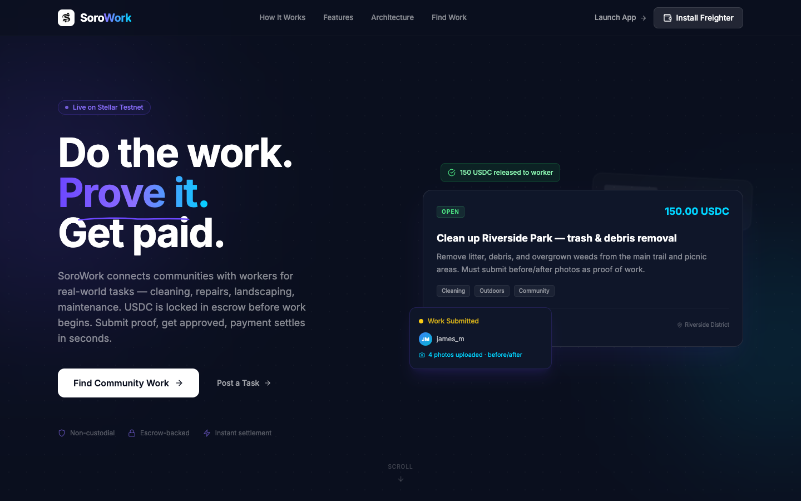
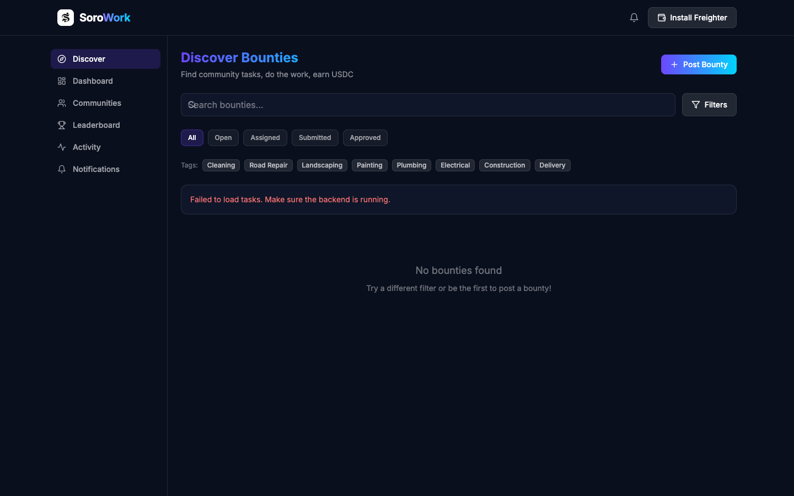

<div align="center">

<h1>&nbsp; SoroWork</h1>

### Do the work. Prove it. Get paid.

**Community work, paid trustlessly on Stellar.**

SoroWork is a decentralized platform that connects communities with local workers for real-world tasks — cleaning, repairs, landscaping, painting, road maintenance, and more. Funds are locked in smart contract escrow on Stellar, workers submit photo proof when the job is done, and payment settles in seconds as USDC.

No middlemen. No delayed payments. No trust required.

[Website](https://sorowork.xyz) · [Documentation](https://docs.sorowork.xyz)

---

</div>

## 📸 Preview

<div align="center">





</div>

---

## 🧩 How It Works

```
Community Leader                    SoroWork                           Worker
     │                                │                                  │
     │  1. Posts a task               │                                  │
     │  ("Clean Riverside Park")      │                                  │
     ├───────────────────────────────►│                                  │
     │                                │                                  │
     │  2. USDC locked in escrow      │                                  │
     │  (Soroban smart contract)      │                                  │
     │◄───────────────────────────────┤                                  │
     │                                │  3. Worker picks up task         │
     │                                │◄─────────────────────────────────┤
     │                                │                                  │
     │                                │  4. Submits proof (photos)       │
     │                                │◄─────────────────────────────────┤
     │                                │                                  │
     │  5. Reviews & approves         │                                  │
     ├───────────────────────────────►│                                  │
     │                                │  6. USDC released instantly      │
     │                                ├─────────────────────────────────►│
     │                                │                                  │
```

---

## 🏗️ Architecture

SoroWork is built across **three repositories**, each handling a distinct layer of the platform:

| Repository | Description | Tech Stack |
|:--|:--|:--|
| **[sorowork-contracts](https://github.com/SoroWork/sorowork-contracts)** | Soroban smart contracts — escrow, treasury, contribution registry | Rust, Soroban SDK |
| **[sorowork-backend](https://github.com/SoroWork/sorowork-backend)** | REST API, task management, user profiles, notifications | Node.js, Express, Prisma, PostgreSQL |
| **[sorowork-interface](https://github.com/SoroWork/sorowork-interface)** | Web frontend — browse tasks, submit proof, manage wallet | React, Vite, TypeScript, Tailwind CSS |

### Smart Contracts

| Contract | Purpose |
|:--|:--|
| **BountyEscrow** | Locks USDC when a task is posted, releases it to the worker when proof is approved. Handles refunds if cancelled. |
| **CommunityTreasury** | Community-managed pool of funds. Admins can distribute rewards for completed work. Anyone can deposit. |
| **ContributionRegistry** | Append-only on-chain record of every verified contribution — task ID, evidence hash, reward, and quality score. |

---

## 🌍 What Kind of Work?

SoroWork is built for **real-world community tasks** — physical work that makes neighborhoods better:

| Category | Examples |
|:--|:--|
| 🧹 **Cleanup** | Park cleanups, litter removal, debris clearing |
| 🔧 **Repair** | Pothole filling, fence fixing, bench repair |
| 🌿 **Landscaping** | Planting, mowing, tree trimming, garden maintenance |
| 🎨 **Painting** | Mural painting, wall repainting, graffiti removal |
| 🏗️ **Construction** | Sidewalk repair, ramp building, playground equipment |
| 🌱 **Environmental** | Stream cleanup, invasive species removal, composting |
| 🛡️ **Safety** | Streetlight repair, sign installation, crosswalk painting |
| 🔧 **Maintenance** | Public restroom maintenance, drain clearing, trail upkeep |

---

## 💰 Payment Flow

- **Currency**: USDC (stablecoin on Stellar)
- **Escrow**: Funds locked in a Soroban smart contract at task creation
- **Release**: Automatic when the community leader approves submitted proof
- **Settlement**: Near-instant on Stellar (~5 second finality)
- **Fees**: Minimal Stellar network fees (fractions of a cent)
- **Wallet**: Non-custodial via [Freighter](https://freighter.app) browser extension

---

## 🔐 Trust Model

| Principle | How |
|:--|:--|
| **Non-custodial** | Users keep their own keys via Freighter. SoroWork never holds funds. |
| **Escrow-backed** | USDC is locked in a smart contract before work begins. No IOUs. |
| **Proof-based** | Workers submit photo evidence. Community leaders verify before release. |
| **On-chain record** | Every approved contribution is permanently recorded in ContributionRegistry. |
| **Reputation** | Workers build on-chain reputation scores based on completed work quality. |

---

## 🚀 Getting Started

### For Community Leaders
1. Install the [Freighter wallet](https://freighter.app)
2. Fund your wallet with testnet USDC
3. Post a community task with a description, location, and reward
4. Review submitted proof and approve to release payment

### For Workers
1. Install the [Freighter wallet](https://freighter.app)
2. Browse available tasks in your area
3. Pick up a task and complete the work
4. Submit before/after photos as proof
5. Get paid in USDC when approved

---

## 🛠️ Development

```bash
# Contracts (Rust/Soroban)
cd sorowork-contracts
make build
make test

# Backend (Node.js)
cd sorowork-backend
npm install
cp .env.example .env
npm run dev

# Frontend (React/Vite)
cd sorowork-interface
npm install
cp .env.example .env
npm run dev
```

---

## 🌐 Built On

<div align="center">

**Stellar** · **Soroban** · **USDC** · **Freighter**

The fast, low-cost, energy-efficient blockchain for real-world payments.

</div>

---

<div align="center">

**SoroWork** — Connecting communities with the workers who make them better.

</div>
